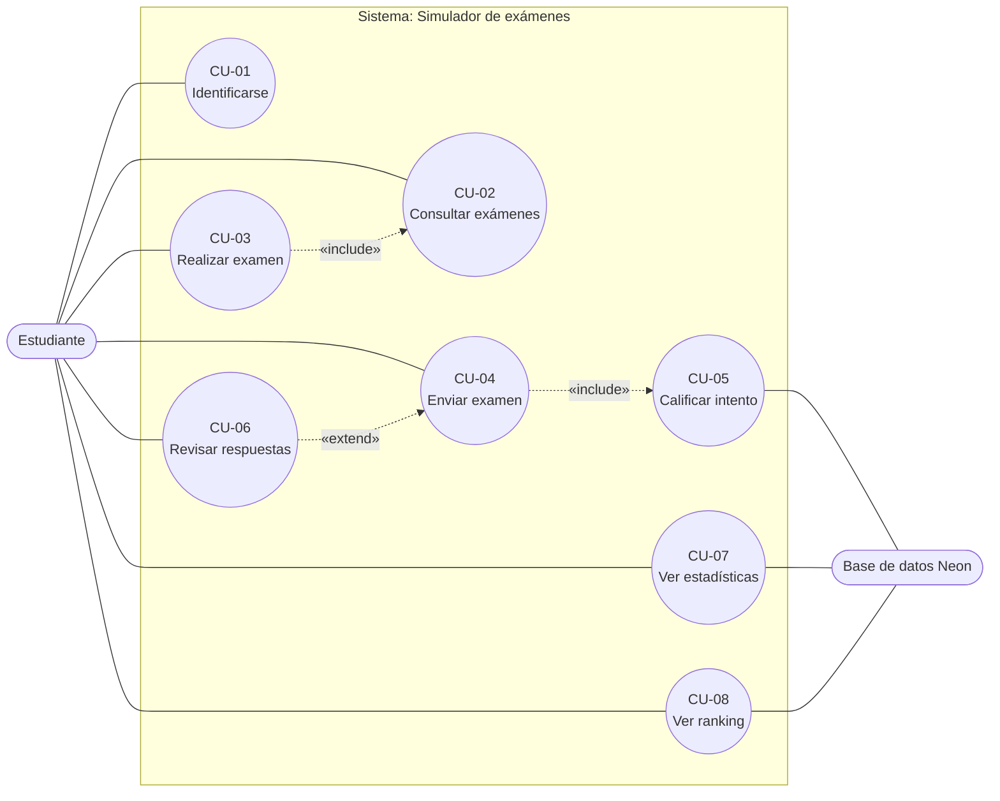
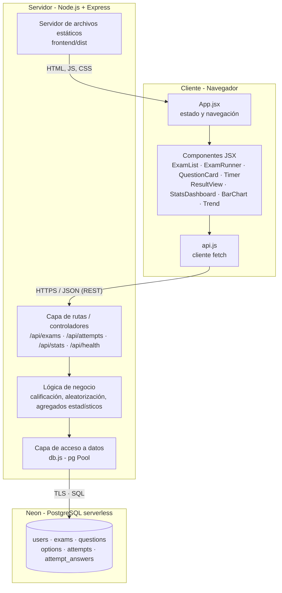
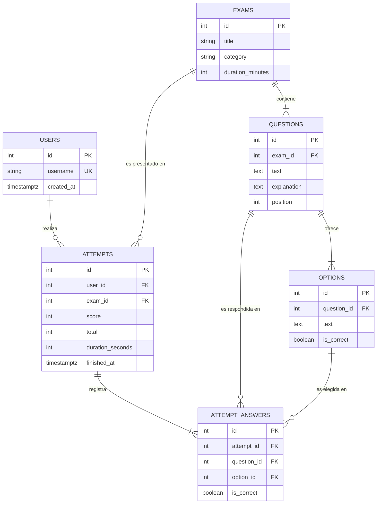
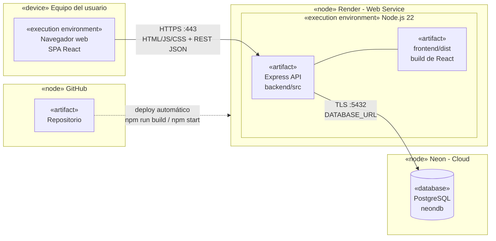

# Documentación de modelamiento de software
**Proyecto:** Simulador de exámenes con estadísticas
**Stack:** React (JSX) · Express/Node.js · PostgreSQL (Neon) · Render

> Los diagramas están escritos en **Mermaid**. Se visualizan directamente en GitHub, VS Code (extensión Markdown Preview Mermaid) o en https://mermaid.live, desde donde puedes exportarlos como imagen para tu entrega.

---

## 1. Descripción general
Aplicación web cliente-servidor que permite a un estudiante presentar exámenes de opción múltiple con
cronómetro, recibir su calificación inmediata con retroalimentación, y consultar estadísticas de su desempeño.
La calificación se realiza en el servidor para que el cliente nunca conozca las respuestas correctas antes de enviar.

### Requisitos funcionales
| Id | Requisito |
|----|-----------|
| RF-01 | El sistema debe permitir al usuario identificarse con un nombre. |
| RF-02 | El sistema debe listar los exámenes disponibles con su duración, número de preguntas y promedio global. |
| RF-03 | El sistema debe presentar las preguntas en orden aleatorio, con un cronómetro regresivo. |
| RF-04 | El sistema debe enviar el examen automáticamente al agotarse el tiempo. |
| RF-05 | El sistema debe calificar el intento en el servidor y guardarlo. |
| RF-06 | El sistema debe mostrar la revisión de cada pregunta con la respuesta correcta y su explicación. |
| RF-07 | El sistema debe mostrar estadísticas personales: promedio, mejor nota, evolución, promedio por examen y preguntas más falladas. |
| RF-08 | El sistema debe mostrar un ranking de usuarios por promedio. |

### Requisitos no funcionales
- Interfaz adaptable (responsive) y accesible por teclado.
- Comunicación cliente-servidor mediante API REST en JSON sobre HTTPS.
- Persistencia en PostgreSQL con integridad referencial y transacciones al guardar un intento.
- Despliegue en la nube con la base de datos separada del servidor de aplicación.

---

## 2. Casos de uso

### 2.1 Diagrama de casos de uso


### 2.2 Actores
| Actor | Tipo | Descripción |
|-------|------|-------------|
| Estudiante | Principal | Persona que presenta exámenes y consulta su progreso. |
| Base de datos Neon | Secundario (sistema) | Almacena exámenes, intentos y respuestas. |

### 2.3 Especificación de casos de uso

**CU-03 Realizar examen**
| Campo | Descripción |
|-------|-------------|
| Actor | Estudiante |
| Precondición | El estudiante se ha identificado (CU-01) y existe al menos un examen. |
| Disparador | El estudiante pulsa «Comenzar examen». |
| Flujo principal | 1. El sistema solicita el examen al servidor. 2. El servidor devuelve preguntas y opciones en orden aleatorio, sin respuestas correctas. 3. El sistema inicia el cronómetro. 4. El estudiante selecciona una opción por pregunta y puede navegar entre ellas. 5. El estudiante envía el examen (CU-04). |
| Flujo alterno A | El tiempo llega a cero: el sistema envía automáticamente las respuestas registradas hasta ese momento. |
| Flujo alterno B | El estudiante pulsa «Salir»: el sistema pide confirmación y descarta el intento sin guardarlo. |
| Postcondición | Las respuestas quedan listas para ser enviadas. |

**CU-04 Enviar examen**
| Campo | Descripción |
|-------|-------------|
| Actor | Estudiante |
| Precondición | Hay un examen en curso. |
| Flujo principal | 1. El estudiante pulsa «Enviar examen». 2. El sistema advierte si quedan preguntas sin responder y pide confirmar. 3. El sistema envía las respuestas a la API. 4. El servidor califica (CU-05) y guarda el intento. 5. El sistema muestra el resultado. |
| Flujo alterno | Error de red o de servidor: se muestra el mensaje y el estudiante puede reintentar el envío. |
| Postcondición | El intento y sus respuestas quedan guardados en la base de datos. |

**CU-07 Ver estadísticas**
| Campo | Descripción |
|-------|-------------|
| Actor | Estudiante |
| Precondición | El estudiante se ha identificado. |
| Flujo principal | 1. El estudiante abre «Mis estadísticas». 2. El sistema consulta resumen, historial, promedio por examen y preguntas más falladas. 3. El sistema presenta indicadores, gráfico de evolución y gráfico de barras. |
| Flujo alterno | El estudiante aún no tiene intentos: se muestra un mensaje invitándolo a realizar su primer examen. |
| Postcondición | Ninguna (consulta). |

---

## 3. Diagrama arquitectónico

Arquitectura **cliente-servidor en capas** con API REST. El frontend (SPA React) consume la API de Express;
Express accede a PostgreSQL (Neon) mediante el controlador `pg`.



| Capa | Tecnología | Responsabilidad |
|------|------------|-----------------|
| Presentación | React 18 + Vite (JSX) | Interfaz, cronómetro, gráficos, estado de la sesión de examen. |
| API / Negocio | Express 4 | Validación, calificación del intento, consultas estadísticas. |
| Datos | pg + PostgreSQL (Neon) | Persistencia, integridad referencial, transacciones. |

### 3.1 Modelo de datos


### 3.2 Secuencia: enviar un examen
```mermaid
sequenceDiagram
  actor U as Estudiante
  participant R as React (ExamRunner)
  participant E as Express (/api/attempts)
  participant N as Neon (PostgreSQL)

  U->>R: Pulsa «Enviar examen»
  R->>E: POST /api/attempts {username, examId, answers}
  E->>N: BEGIN; upsert usuario
  E->>N: SELECT preguntas y opciones del examen
  N-->>E: Preguntas con is_correct
  E->>E: Califica y arma la revisión
  E->>N: INSERT attempts y attempt_answers; COMMIT
  E-->>R: 201 {score, total, percentage, review}
  R-->>U: Muestra el resultado
```

---

## 4. Diagrama de despliegue



| Nodo | Artefactos | Configuración |
|------|-----------|---------------|
| Navegador | SPA React | Accede por HTTPS a la URL pública de Render. |
| Render Web Service | Express + `frontend/dist` | Build `npm run build`, start `npm start`, variable `DATABASE_URL`. |
| Neon | Base `neondb` | Conexión TLS (`sslmode=require`); esquema en `database/schema.sql`. |
| GitHub | Código fuente | Origen del despliegue continuo en Render. |

---

## 5. Evidencia del despliegue
Adjunta aquí las capturas (ver lista en el README):
1. Panel de Neon con las tablas creadas.
2. Servicio en Render con estado *Live* y logs del build.
3. `/api/health` respondiendo `connected`.
4. La aplicación funcionando en la URL pública.

**URL pública:** _____________________________  **Repositorio:** _____________________________
